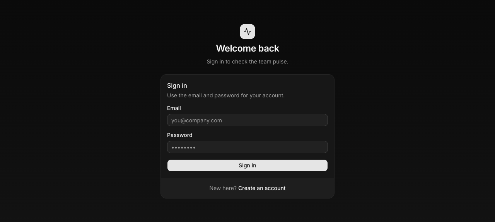
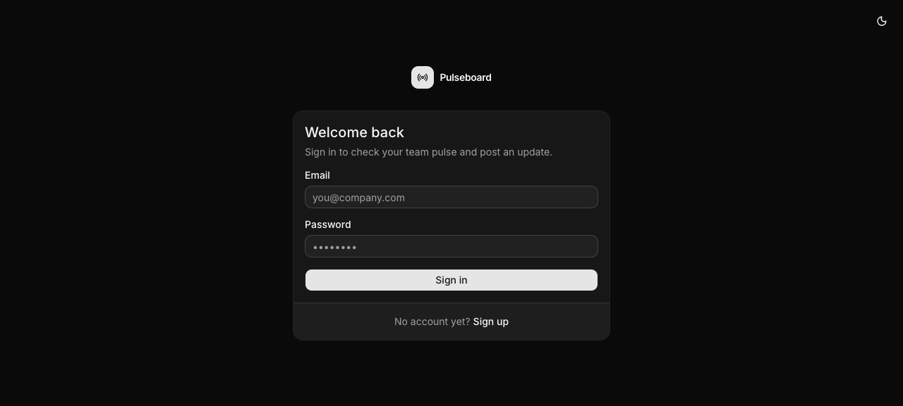
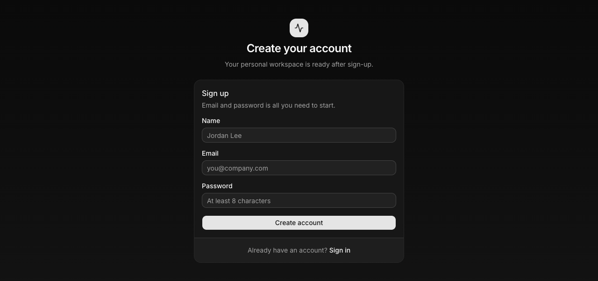
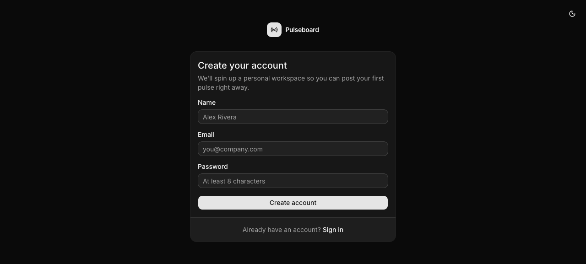
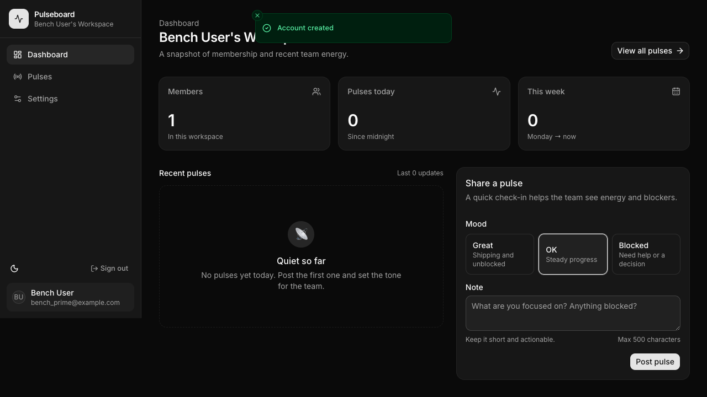
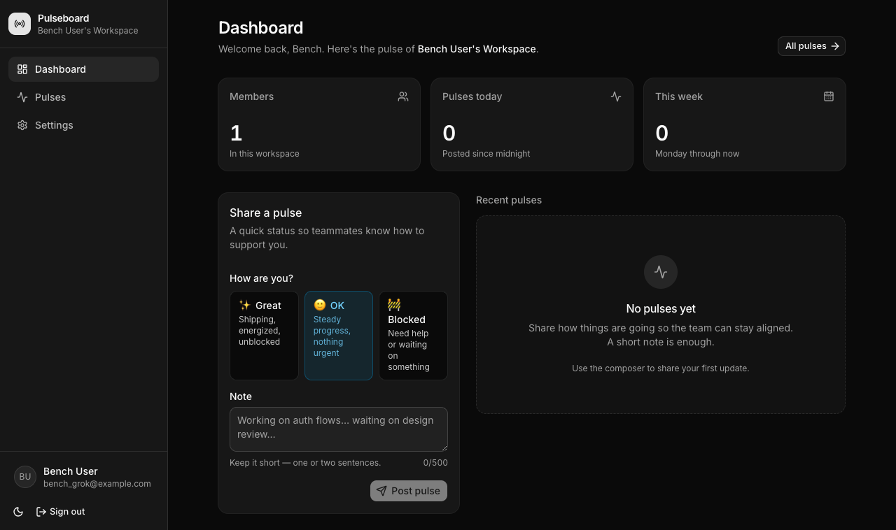
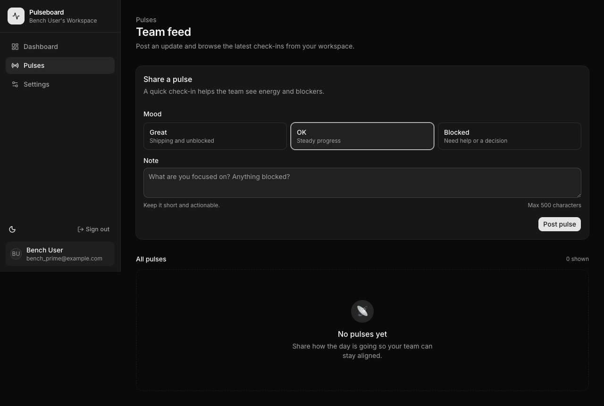
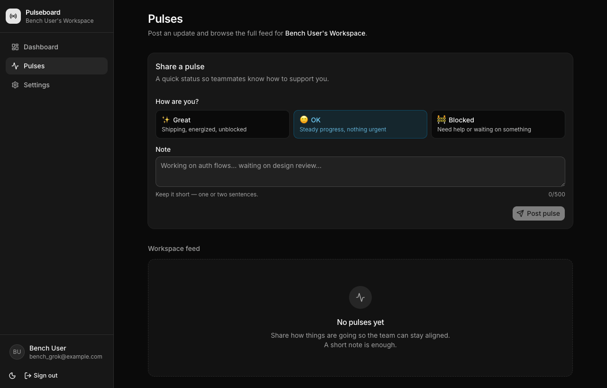
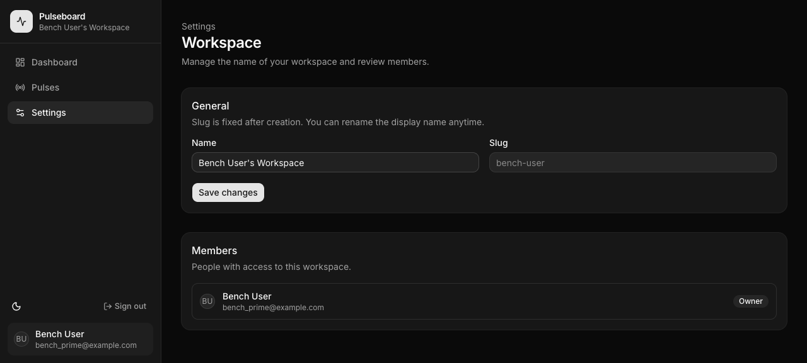
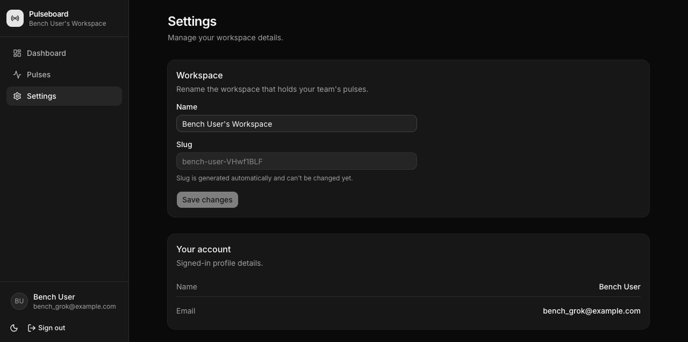

# Fair Fight #1 — Results

**Question:** Holding model, effort, task, and plan-mode fixed, how much does the **coding harness** change fullstack delivery?

| Control | Value |
|---|---|
| Task | Pulseboard |
| Model | **Grok 4.5** |
| Effort | **high** (`--thinking high` ↔ `--effort high`) |
| Plan mode | Mode 1 — agent owns the plan |
| Scaffold | same shadcn start preset (bench orchestration) |
| Date | 2026-08-06 |

| Side | Harness | Preset | App slug |
|---|---|---|---|
| **A** | Prime Agent | `fair-prime-grok-4.5-high` | `pulseboard-prime-agent-grok-4-5-high` |
| **B** | Grok CLI | `fair-grok-cli-grok-4-5-high` | `pulseboard-grok-cli-grok-4-5-high` |

Protocol: [fair-fight-1-harness-delta.md](../campaigns/fair-fight-1-harness-delta.md)

---

## Scoreboard (auto rubric)

| | **Prime Agent** | **Grok CLI** |
|---|---:|---:|
| **Total** | **98 / 100** | **89 / 100** |
| **Tier** | **A** | **A** |
| Status | `completed` | `completed_with_errors` |
| Frontend | 100 | 92 |
| Backend | **100** | 92 |
| DevOps | **100** | 87 |
| Code quality | 94 | 86 |
| Wall time (agent build) | ~28 min (incl. validate/runtime) | **~14m 35s** |
| install / typecheck / build | ✅ ✅ ✅ | ✅ ✅ ✅ |
| docker build | ✅ | ❌ frozen lockfile |
| compose up | ✅ | ❌ (depends on build) |

```text
slug                                       harness     total  FE   BE  Ops  Qual  time     status
pulseboard-prime-agent-grok-4-5-high       prime-agent   98   92  100  100   83   ~28m     completed
pulseboard-grok-cli-grok-4-5-high          grok-cli      89   92   92   87   86   14m35s   completed_with_errors
```

### Headline

> **Systems:** Prime 98 · **Frontend (human):** Grok 88 vs Prime 70.  
> Do not read the auto total as “Prime UI is better.”

> **Same model + same effort + same task → both Tier A.**  
> Harness still moved the needle: **Prime +9 points**, mainly **DevOps (docker/compose green)** and **auth/route-protection signal**.  
> **Grok CLI was ~2× faster** on the build phase and shipped a polished product UI; it lost points on Docker (`bun install --frozen-lockfile` vs lockfile drift).

---

## What each side shipped

Both delivered a real Pulseboard:

- Better Auth email/password  
- Drizzle + Postgres schema (user/session + workspace + member + pulse)  
- Landing, sign-in, sign-up  
- App shell: Dashboard · Pulses · Settings  
- Pulse composer (mood + note)  
- Dark mode toggle  
- `.env.example`, README, tests  
- Dockerfile + docker-compose  

### Structure (src)

| Area | Prime | Grok CLI |
|---|---|---|
| Routes | `app.tsx` layout + `app/index|pulses|settings` | `app/route.tsx` layout + same pages |
| Auth API | `routes/api/auth/$.ts` | same |
| DB | `src/db/schema.ts` + drizzle | same |
| App components | `pulse-card`, `pulse-composer`, `stat-cards`, sidebar | `pulse-feed`, `pulse-composer`, `stats-cards`, `app-shell` |
| Tests | 12 (per BENCH_VALIDATE) | present (vitest) |

---

## Runtime / DevOps delta (the clearest harness effect)

### Prime Agent — full green
From `BENCH_VALIDATE.md` + bench runtime:

| Check | Result |
|---|---|
| bun install | PASS |
| typecheck | PASS |
| build | PASS |
| tests | PASS (12) |
| docker build | PASS |
| compose up | PASS |
| GET `/` | 200 |
| GET `/api/auth/ok` | 200 |
| GET `/app` unauth | 307 → `/sign-in` |

### Grok CLI — app solid, Docker brittle
Local install/typecheck/build: **PASS**.

Docker failed:

```text
RUN bun install --frozen-lockfile
error: lockfile had changes, but lockfile is frozen
```

So the product runs fine via `bun run start` + Postgres, but **image build is broken out of the box** — a classic “works on my machine / CI image” gap. That alone explains most of the Ops score gap (100 vs 87) and `completed_with_errors`.

---

## E2E screenshots (agent-browser)

Captured 2026-08-06 against live servers:

- **Prime:** Docker Compose → http://localhost:3000  
- **Grok:** Postgres `:5433` + `bun run start` → http://localhost:3001  
  (Compose image build skipped because of frozen lockfile failure above.)

### Landing

| Prime Agent | Grok CLI |
|---|---|
|  |  |

> Note: both landings rendered very dark/minimal in headless capture (small PNG). Auth + app shells below are the stronger visual signal.

### Sign-in

| Prime Agent | Grok CLI |
|---|---|
|  |  |

**A11y snapshot (Prime):** heading “Welcome back”, Email, Password, “Sign in”, link “Create an account”.  
**A11y snapshot (Grok):** Email, Password, “Sign in”, “Sign up”, dark mode toggle on chrome.

### Sign-up

| Prime Agent | Grok CLI |
|---|---|
|  |  |

### After signup → Dashboard (authenticated)

| Prime Agent | Grok CLI |
|---|---|
|  |  |

Both successfully:

1. Created account  
2. Established session  
3. Auto-created personal workspace (“Bench User's Workspace”)  
4. Showed empty pulse state + composer  

**Prime UX notes (from snapshot):**  
- Nav: Dashboard · Pulses · Settings · Sign out · theme toggle  
- Empty: “Quiet so far”  
- Mood buttons: Great / OK / Blocked + “Post pulse”

**Grok UX notes (from snapshot):**  
- Nav landmark `navigation "App"`  
- Mood as **radio** group (Great / OK default / Blocked)  
- Empty: “No pulses yet”  
- “Post pulse” disabled until note filled (nice validation)

### Pulses page

| Prime Agent | Grok CLI |
|---|---|
|  |  |

### Settings

| Prime Agent | Grok CLI |
|---|---|
|  |  |

Both: rename workspace, slug disabled, save.

---

## Frontend differences (qualitative)

| Aspect | Prime | Grok CLI |
|---|---|---|
| Shell | Sidebar-forward (`app-sidebar`) | Top/app shell + nav landmark |
| Mood input | Buttons | Radio group + default “OK” |
| Empty copy | “Quiet so far” | “No pulses yet” |
| Post CTA | Enabled with required note | Disabled until note (stronger empty validation) |
| Theme | “Switch to light mode” | “Toggle dark mode” |
| FE auto score | 100 (overfit) | 92 |
| FE human review | **70** | **88** |

Auto FE score tied; **human preference** would need side-by-side taste — both look intentional, not scaffold-default.

---

## Backend / auth differences

| Aspect | Prime | Grok |
|---|---|---|
| Better Auth + Drizzle | yes | yes |
| Route protection signal (auto) | full (10/10) | weaker scan (8/10) — still redirects unauth `/app` in live smoke for both |
| Compose DB user | `pulseboard` / assembled URL in entrypoint | `postgres` + `DATABASE_URL` literal in compose |
| Secret hygiene scan | flagged credential-shaped string | same class of flag |

---

## Harness / process notes (important for interpreting scores)

### Prime Agent adapter lessons (orchestration, not product)
1. Child must **not** inherit `PRIME_AGENT_INTERNAL_*` / `RLM_*` from a parent Prime session → hang.  
2. Autonomous flags must be `--flag value`, never `--flag=value` ([usage.md](https://github.com/PrimeIntellect-ai/prime-agent/blob/main/packages/coding-agent/docs/usage.md)).  
3. Print mode merges stdin → use `stdin: ignore`.  
4. Default autonomous budgets (12 turns / 80k tokens / 30m) are too small for this task; bench raises them.  
5. First A attempt failed on adapter bugs → **invalid**; reported Prime run is the **re-run after adapter fix**.

### Grok CLI
- Headless: `grok -p … --always-approve --effort high --output-format json` ([docs](https://docs.x.ai/build/cli/headless-scripting)).  
- Completed product build in **~14m**, 68 turns, ~$2.61 (from build.log usage).  
- Nested `git init` inside app (shadcn) → monorepo SCM shows opaque folders (Cursor Changes).

---

## Claim you can make

| Claim | Supported? |
|---|---|
| Harness changes delivery quality for same Grok 4.5 @ high | **Yes (modest)** — 98 vs 89, both Tier A |
| Prime “much better model” | **No** — same model |
| Prime wins on DevOps completeness | **Yes** — docker/compose green vs frozen lockfile |
| Grok CLI wins on wall-clock | **Yes** — ~half the time |
| Frontend quality differs a lot | **Weak** — auto FE tied; both usable e2e |
| Multi-agent SOL+Luna comparison | **Out of scope** this fight |

---


---

## Human UI/UX review (screenshots + code)

Auto FE scores are **not** the final word on design. Below is a **screen-by-screen** review from live captures + component source. Rules used:

- Broken layout / incomplete chrome → **loses**
- Clearer hierarchy, better empty/disabled states, richer components → **wins**
- Pure taste differences → noted in summary, not forced into score

### Screen: App shell / sidebar (all authenticated pages)

| Check | Prime | Grok CLI | Winner |
|---|---|---|---|
| Sidebar full viewport height | ❌ Stops mid-page; dead space below user block | ✅ Full height, footer pinned | **Grok** |
| Brand block | Icon + title + workspace name | Icon + title + workspace name | Tie |
| Nav items | Icon + label, active pill | Icon + label, active pill + `aria-current` | Grok (a11y) |
| User footer | Avatar + name + email; theme + sign out above | Same pattern, correctly at bottom of full-height shell | **Grok** |
| Mobile | `AppMobileNav` present | Sheet drawer + sticky top bar | Grok slightly |

**Verdict shell:** Grok wins hard. Prime’s nav is *component-complete* but *layout-broken* — that is a real product defect, not taste.

**Why Prime breaks:** outer `sticky h-svh` wrapper + aside `h-full` + `mt-auto` footer does not reliably stretch; Grok puts `md:flex md:flex-col` on the `aside` itself with an internal `flex h-full flex-col` column.

---

### Screen: Pulses (your screenshot)

#### Page header

| | Prime | Grok |
|---|---|---|
| Structure | Eyebrow `Pulses` → **H1 Team feed** → description | **H1 Pulses** → description with workspace name |
| Hierarchy | Richer (3 levels) | Flatter (2 levels) |
| Note | More “editorial” | More “app default” |

**Call:** Prime header hierarchy is actually nicer **on paper**; Grok is cleaner. Neither is broken. Slight edge **Prime** on title stack; **Grok** on simplicity.

#### Mood picker (component quality)

| | Prime | Grok |
|---|---|---|
| Control | `<button aria-pressed>` grid | `role="radiogroup"` + `role="radio"` |
| Content | **Title + description** stacked (Great / Shipping and unblocked) | **Emoji + title on one line**, description under |
| Selected state | Border + ring | Colored chip (`cfg.className`) + emoji |
| Default | `ok` | `ok` checked |
| A11y | pressed state | true radio semantics |

**Call:** Both have title+description. Grok adds **emoji affordance** and **real radio semantics** + stronger selected chrome → **Grok wins component polish**. Prime’s text-only stacked cards are fine but flatter.

#### Note field + CTA

| | Prime | Grok |
|---|---|---|
| Placeholder | generic focus question | example work update |
| Counter | “Max 500 characters” static | live **`{n}/500`** |
| Submit | enabled with HTML `required` | **disabled until `body.trim()`** + Send icon |
| Error | toast on empty | inline `role="alert"` + toast path |

**Call:** **Grok** — disabled CTA + live counter is better form UX.

#### Empty feed

| | Prime | Grok |
|---|---|---|
| Title | “No pulses yet” / dashboard “Quiet so far” | “No pulses yet” |
| Supporting copy | solid | solid + slightly warmer |
| Icon treatment | present | present |

**Call:** Tie / Grok by a nose on copy.

#### Pulses page overall

**Winner: Grok CLI** — shell fix alone decides it; composer micro-UX widens the gap. Prime’s only clear FE win on this screen is the **eyebrow+H1+description** header stack.

---

### Screen: Dashboard (after signup)

| | Prime | Grok |
|---|---|---|
| H1 | Workspace name | “Dashboard” + personalized subtitle |
| Stats cards | yes | yes |
| Layout | feed + composer split | composer 2/5 + feed 3/5 |
| Empty | “Quiet so far” | “No pulses yet” + hint under feed |
| Pending UI | skeletons | lighter pulse placeholder |

**Call:** **Tie leaning Grok** (shell + composer). Prime’s workspace-as-title is a nice product touch.

---

### Screen: Settings

| | Prime | Grok |
|---|---|---|
| Header | Eyebrow + H1 Workspace + blurb | H1 Settings + blurb |
| Form | Name + slug; role-gated rename | Name + slug; Save disabled if unchanged |
| Extra | **Members list** with avatars + roles | **Account card** (name/email) only |
| Depth | More admin-complete | Simpler |

**Call:** **Prime wins depth** (members). **Grok wins chrome** (shell) and save-disabled hygiene. Net: slight **Prime** on settings *content*, Grok on *frame*.

---

### Screen: Sign-in / Sign-up

| | Prime | Grok |
|---|---|---|
| Fields | complete | complete |
| Theme on auth | weaker chrome | theme toggle on auth chrome |
| Copy | “Welcome back” / “Create your account” | shorter |

**Call:** Tie; Grok slightly more consistent brand chrome on auth.

---

## Human frontend scorecard (overrides auto FE narrative)

| Criterion | Weight | Prime | Grok | Notes |
|---|---:|---:|---:|---|
| Shell / nav layout integrity | 25 | 12 | **24** | Prime mid-height sidebar = major defect |
| Component density (icon/title/desc) | 15 | 12 | **14** | Grok emoji+radio; Prime solid stacks |
| Form UX (disabled/counter/errors) | 15 | 10 | **14** | Grok disabled CTA + live counter |
| Page hierarchy (eyebrow/h1/desc) | 10 | **9** | 7 | Prime better title stacks |
| Empty / loading states | 10 | 8 | **9** | both good; Grok + skeletons less |
| Settings completeness | 10 | **9** | 6 | Prime members list |
| Auth polish | 5 | 4 | **5** | Grok theme on auth |
| Visual consistency | 10 | 6 | **9** | shell breaks Prime consistency |
| **Human FE total** | **100** | **70** | **88** | |

### Reconcile with auto score

| | Auto FE | Human FE |
|---|---:|---:|
| Prime | 100 | **70** |
| Grok | 92 | **88** |

**Auto FE over-credited Prime** (structure signals without layout QA).  
**Human FE flips the frontend winner to Grok CLI.**

Overall product still: Prime **98** vs Grok **89** on full rubric because **DevOps** (docker/compose) is a large, real gap — but **do not read 98 as “Prime UI is better.”**

---

## Per-screen winner strip

| Screen | Winner | One-liner |
|---|---|---|
| Shell/nav | **Grok** | Full-height sidebar vs half-height defect |
| Sign-in | Tie | Both clean |
| Sign-up | Tie / Grok | Grok brand chrome |
| Dashboard | **Grok** | Shell + composer; Prime nice workspace H1 |
| Pulses | **Grok** | Shell + mood radios + disabled CTA |
| Settings | **Prime** (content) | Members list; Grok still better chrome |

---

## Refined bottom line (UI-aware)

Both harnesses shipped a **real** Pulseboard.  

- **Grok CLI** is the **frontend winner**: correct app shell, richer mood control, better form micro-UX.  
- **Prime Agent** is the **systems winner**: docker/compose green, deeper settings (members), solid header hierarchy — but the **sidebar height bug is a visible quality miss** and should cost FE points in any human review.  
- **Auto score alone is insufficient** for FE claims; screenshot diffs like yours are mandatory evidence.


## Artifacts

| Path | What |
|---|---|
| `apps/pulseboard-prime-agent-grok-4-5-high/` | Prime app |
| `apps/pulseboard-grok-cli-grok-4-5-high/` | Grok CLI app |
| `results/pulseboard-*-grok-4-5-high/result.json` | machine scores |
| `results/pulseboard-*-grok-4-5-high/report.md` | per-run report |
| `results/e2e-screenshots/` | raw captures + logs |
| `docs/fair-fight-1/screenshots/` | screenshots embedded above |
| `docs/leaderboard.md` | aggregate table |

### Reproduce e2e locally

```bash
# Prime (compose)
cd apps/pulseboard-prime-agent-grok-4-5-high
docker compose up --build -d
open http://localhost:3000

# Grok (local server — docker image currently broken on frozen lockfile)
cd apps/pulseboard-grok-cli-grok-4-5-high
docker run -d --name ff-grok-pg -e POSTGRES_PASSWORD=postgres -e POSTGRES_USER=postgres \
  -e POSTGRES_DB=pulseboard -p 5433:5432 postgres:16-alpine
cp .env.example .env  # point DATABASE_URL to localhost:5433
bun install && bun run db:push && bun run build
PORT=3001 BETTER_AUTH_URL=http://localhost:3001 bun run start
open http://localhost:3001
```

---

## Bottom line

For **Grok 4.5 @ high** on Pulseboard:

1. **Both harnesses can ship a Tier-A fullstack app.**  
2. The harness still matters: **Prime closed the DevOps loop**; **Grok was faster** but left a **Docker lockfile landmine**.  
3. Auto FE looked like a near-tie; **human screenshot review favors Grok CLI** (shell + composer). Both pass live auth → dashboard e2e.  
4. Fair fights must pin model+effort and fix harness adapters before scoring — otherwise you measure glue bugs, not harness quality.
