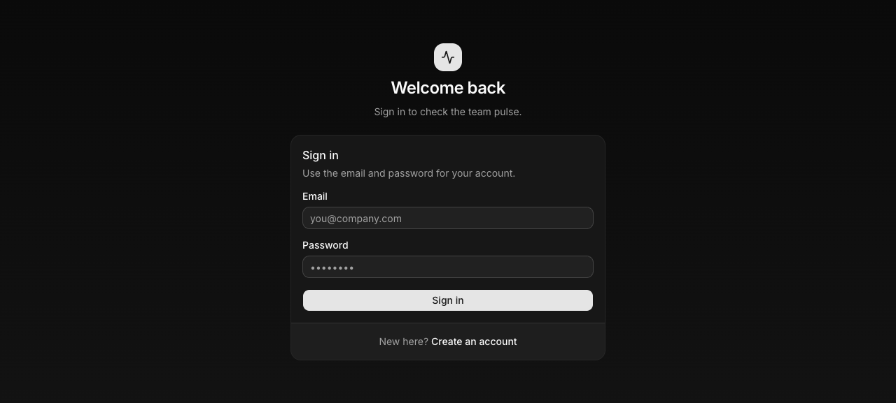
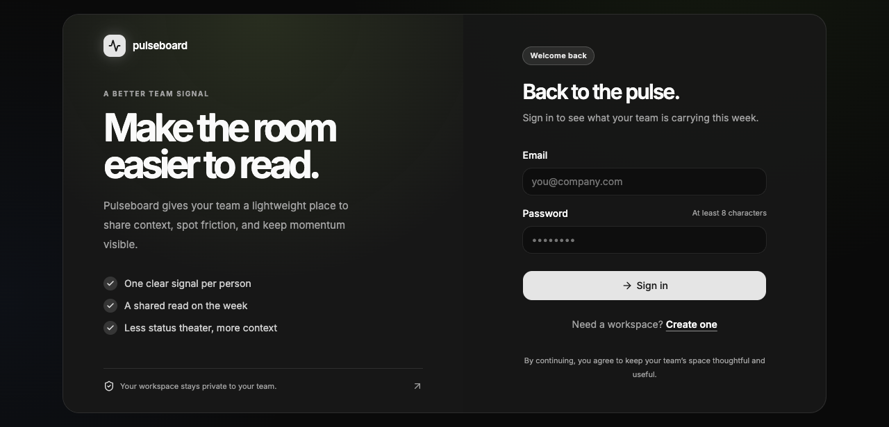
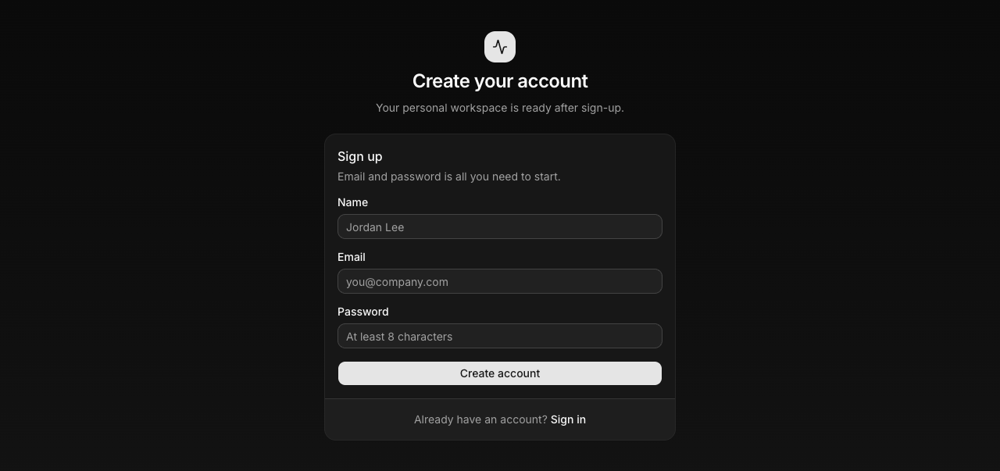
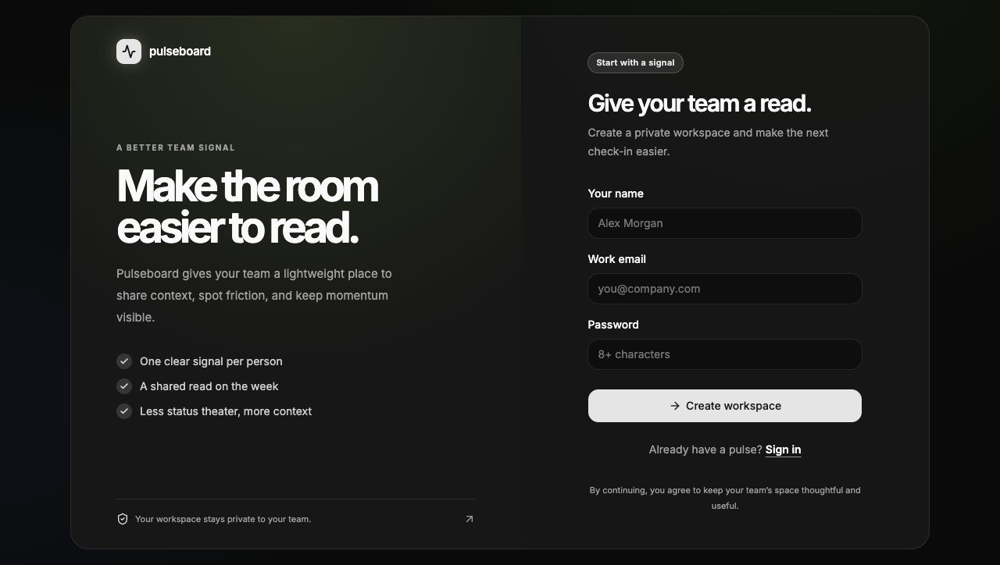
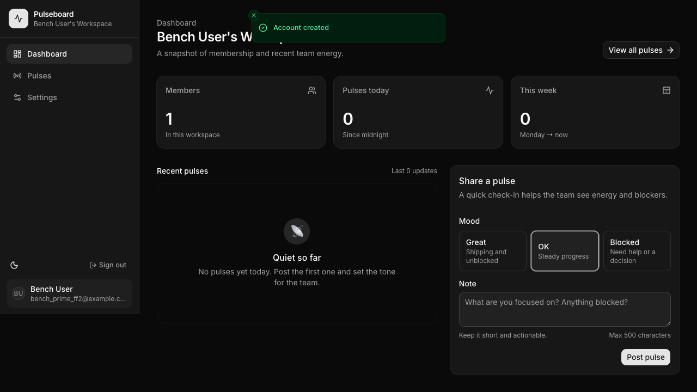
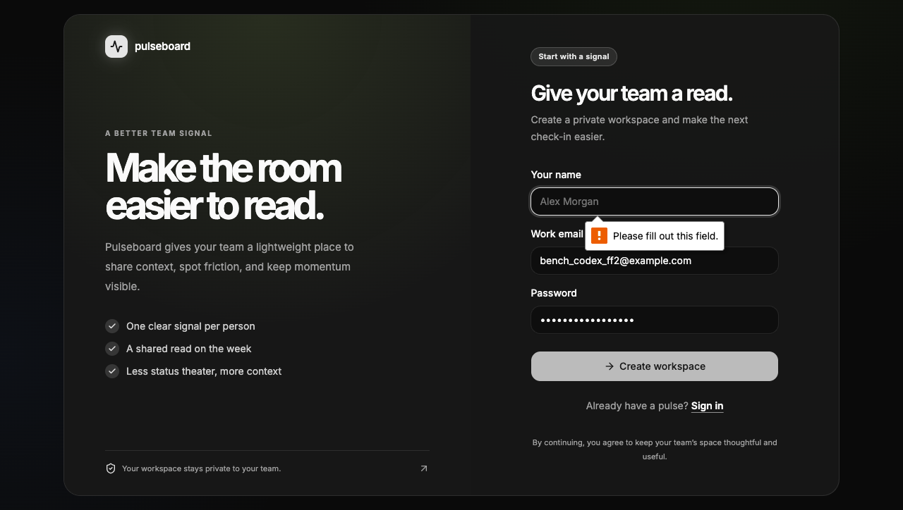
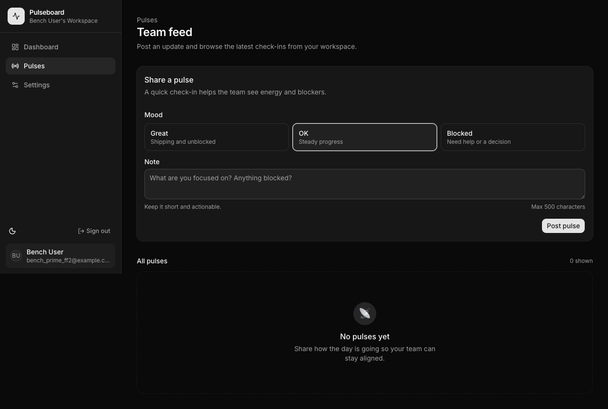
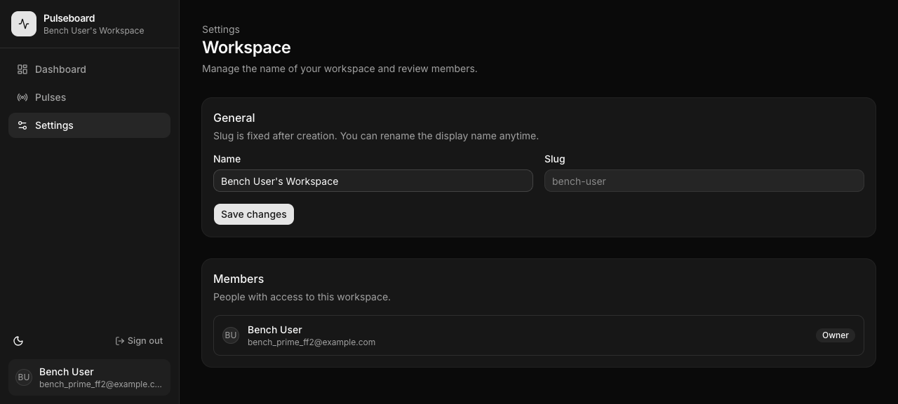
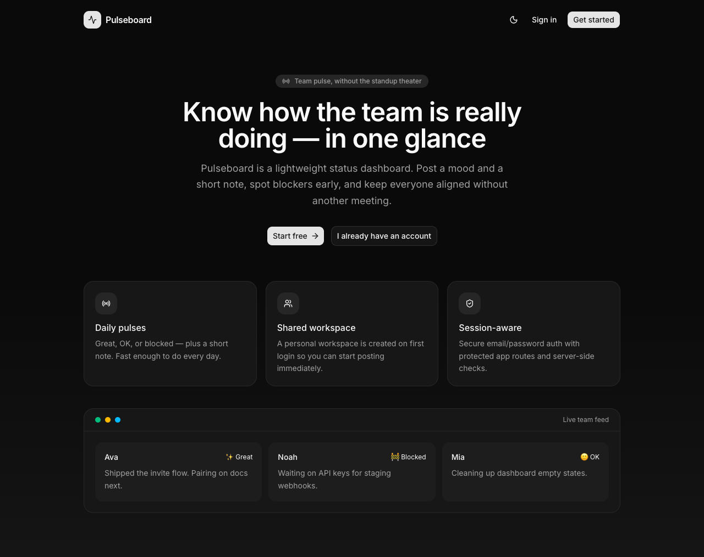

# Fair Fight #2 — Results

**Question:** Same model (**GPT-5.6 Luna**) + same effort (**xhigh**) + same Pulseboard task — how much does the harness change delivery: **Prime Agent vs Codex CLI**?

| Control | Value |
|---|---|
| Task | Pulseboard |
| Model | `gpt-5.6-luna` |
| Effort | **xhigh** (`--thinking xhigh` ↔ `model_reasoning_effort=xhigh`) |
| Plan mode | Mode 1 — agent owns plan |
| Date | 2026-08-06 |
| **Not used** | Grok (session isolation verified) |

| Side | Harness | Preset | Slug |
|---|---|---|---|
| **A** | Prime Agent | `fair-prime-luna-xhigh` | `pulseboard-prime-agent-luna-xhigh` |
| **B** | Codex CLI | `fair-codex-luna-xhigh` | `pulseboard-codex-luna-xhigh` |

---

## Attempts (Prime side)

| # | Outcome | Why |
|---|---|---|
| **1** | **timeout / agent_hang** | After writing app + `dist/`, process idled ~43m (0% CPU), left `vite dev :3000`, never exited. Controls OK (Luna@xhigh). See `results/.../attempts/attempt-1-hang/HANG.md`. |
| **2** | **completed (score 98)** with agent exit≠0 | Mitigations: stream log, session-dir, idle watchdog, orphan kill, completion contract. Agent hit **`maxTurns 223/200`** → exit 1, but product + bench runtime all green. |

Codex ran once (after A2 finished).

---

## Scoreboard (auto rubric · attempt 2)

| | **Prime Agent** | **Codex CLI** |
|---|---:|---:|
| **Total** | **98 / 100** | **89 / 100** |
| **Tier** | **A** | **A** |
| Status | `completed` (phase build exit 1 / maxTurns) | `completed_with_errors` |
| Frontend (auto) | 100 | 92 |
| Backend | 100 | 100 |
| DevOps | **100** | 87 |
| Code quality | 94 | 80 |
| Wall time | **~1h 04m** | **~38m** |
| install / tsc / build | ✅ ✅ ✅ | ✅ ✅ ✅ |
| docker build | ✅ | ❌ `COPY . .` vs node_modules clash |
| compose up | ✅ | ❌ missing `POSTGRES_PASSWORD` |

```text
slug                                  harness       total  FE   BE  Ops  Qual  time    status
pulseboard-prime-agent-luna-xhigh     prime-agent     98  100  100  100   94   1h04m   completed*
pulseboard-codex-luna-xhigh           codex           89   92  100   87   80   38m19s  completed_with_errors
* agent process exited 1 (maxTurns) after shipping; runtime score still all green
```

---

## What broke where

### Prime attempt 1 — hang (documented, not scored as win)
- Idle event loop after build  
- Orphan vite on :3000  
- No streaming log → invisible hang  
- **Bench fixed before attempt 2**

### Prime attempt 2 — maxTurns
```
Autonomous run stopped before terminal evidence; maxTurns reached (223/200)
```
Still produced full app + passed install/typecheck/build/docker/compose. Treat as **shipped with sloppy exit**, not empty failure.

### Codex — Docker / compose
1. **docker build:** `COPY . .` tries to overwrite `node_modules/better-auth` directory with a file (Docker layer bug / bad context)  
2. **compose:** requires `POSTGRES_PASSWORD` env — not defaulted → interpolate error  

Local `vite preview` + Postgres works for smoke.

### Codex — e2e auth (this capture)
Automated signup **did not enter the app** (stayed on sign-up / redirected `/app` → sign-in). Possible causes: form field names (`Your name` / `Work email`), client auth wiring, or preview SSR cookie issues. **Prime e2e auth succeeded** in the same harness script.

---

## E2E screenshots (side by side)

Paths: `docs/fair-fight-2/screenshots/{prime,codex}/` and site `/fights/fair-fight-2`.

### Sign-in

| Prime Agent | Codex CLI |
|---|---|
|  |  |

- **Prime:** classic “Welcome back” + Email/Password  
- **Codex:** marketing-style split copy (“Make the room easier to read.”) + form — **more designed auth chrome**

### Sign-up

| Prime Agent | Codex CLI |
|---|---|
|  |  |

- **Codex** labels: “Your name”, “Work email”, CTA “Create workspace” — more product marketing  
- **Prime** simpler “Create your account”

### After signup / app

| Prime Agent | Codex CLI |
|---|---|
|  |  |

- **Prime:** reached dashboard (nav + empty pulses + composer) ✅  
- **Codex:** still on sign-up form in this capture ❌ (auth path not closed in e2e)

### Pulses / Settings

| Prime Agent | Codex CLI |
|---|---|
|  |  |
|  |  |

Codex app routes screenshots show **sign-in wall** (same as failed session). Prime shows full shell.

### Landing (Codex stronger)

| Prime | Codex |
|---|---|
|  |  |

Codex landing is a full marketing page (hero, proof grid, footer). Prime landing is thinner in this build.

---

## Human FE notes (FF#2)

| Area | Winner | Note |
|---|---|---|
| Marketing landing | **Codex** | Rich layout, proof sections, brand |
| Auth page design | **Codex** | Stronger copy/visual hierarchy |
| Auth **works** in e2e | **Prime** | Signup → app; Codex stuck |
| App shell when authed | **Prime** (only one we entered) | Nav + dashboard + pulses |
| Docker/compose | **Prime** | All green vs COPY/env failures |
| Speed | **Codex** | ~38m vs ~64m |
| Clean agent exit | **Codex** | exit 0 both phases; Prime maxTurns |

---

## Bottom line

1. **Same Luna @ xhigh** can ship Pulseboard-shaped apps in both harnesses.  
2. **Prime wins systems score (98)** — docker/compose truth + successful live auth e2e.  
3. **Codex is faster and designs a prettier landing/auth**, but **failed docker packaging** and **failed our automated auth entry** — so it loses the fair-fight completion narrative.  
4. **Attempt 1 hang is first-class history** — not deleted; mitigations enabled attempt 2 to finish.  
5. Auto FE=100 for Prime still needs human screenshot caveats (as in FF#1).

---

## Artifacts

| Path | What |
|---|---|
| `apps/pulseboard-prime-agent-luna-xhigh/` | Prime app |
| `apps/pulseboard-codex-luna-xhigh/` | Codex app |
| `results/pulseboard-*-luna-xhigh/result.json` | scores |
| `results/.../attempts/` | Prime attempt 1 hang + attempt 2 snapshot |
| `docs/fair-fight-2/screenshots/` | e2e PNGs |
| Site | `/fights/fair-fight-2` |
